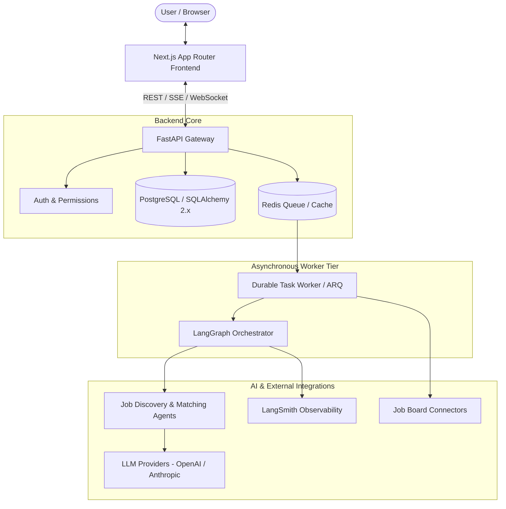

# CareerPilot AI — System Architecture

## 1. Overview
CareerPilot AI is an enterprise-grade, production-oriented autonomous job discovery, recommendation, and application lifecycle platform. The architecture is designed for high availability, modularity, observable agentic workflows, and privacy-first resume handling.



---

## 2. Technology Stack & Component Responsibilities

| Layer | Technology | Primary Responsibility |
|---|---|---|
| **Frontend** | Next.js 16 (App Router), React 19, TypeScript, Tailwind CSS | Responsive dashboard, application tracker, resume editor, real-time match streaming |
| **API Gateway** | FastAPI, Pydantic v2 | High-throughput asynchronous REST endpoints, request validation, authentication, and routing |
| **Database & ORM** | PostgreSQL, SQLAlchemy 2.x (asyncpg), Alembic | Relational data persistence (users, jobs, applications, match scores, audit logs) |
| **Worker & Queue** | Redis, ARQ / Durable Task Worker | Offloading heavy scraping, document parsing, embeddings generation, and agentic workflows |
| **Agentic Workflows** | LangGraph, LangChain, LangSmith | State-machine driven agents for multi-step job analysis, CV tailoring, and cover letter synthesis with full trace observability |
| **Testing** | Pytest, Vitest, Playwright | Multi-tier test pyramid: Unit, Integration, and End-to-End automation |

---

## 3. Monorepo Directory Topology

```text
careerpilot-ai/
├── .env.example              # Centralized environment variable template
├── .gitignore                # Unified gitignore
├── README.md                 # Project root documentation & quickstart
├── docs/                     # Architectural, security, and planning specs
│   ├── architecture.md
│   ├── implementation-plan.md
│   ├── testing-strategy.md
│   └── security.md
├── backend/
│   ├── pyproject.toml        # Backend build, ruff, mypy, pytest config
│   ├── requirements.txt      # Production dependencies
│   ├── requirements-dev.txt  # Development & test dependencies
│   ├── alembic.ini           # Alembic migration configuration
│   ├── app/
│   │   ├── main.py           # FastAPI entrypoint
│   │   ├── core/             # Configuration, logging, database sessions
│   │   ├── api/v1/           # API routes (jobs, applications, resumes, user)
│   │   ├── models/           # SQLAlchemy 2.x declarative models
│   │   ├── schemas/          # Pydantic v2 request/response schemas
│   │   ├── services/         # Domain business logic
│   │   ├── workers/          # Background worker tasks & scheduling
│   │   └── integrations/     # LangGraph agent definitions & external APIs
│   └── tests/                # Pytest unit & integration test suites
└── frontend/
    ├── package.json          # Node dependencies & npm scripts
    ├── tsconfig.json         # Strict TypeScript configuration
    ├── vitest.config.mts     # Vitest runner configuration
    └── src/
        ├── app/              # Next.js App Router pages & layout
        ├── components/       # Reusable UI component library
        └── lib/              # Client API clients & utilities
```

---

## 4. Asynchronous Processing & State Machine Pattern
- **Decoupled API & Ingestion**: Expensive agent runs (e.g. searching 50 job openings, matching skills against a multi-page resume) are enqueued into Redis.
- **LangGraph State Preservation**: Workflows execute as stateful graphs with checkpointing, allowing users to pause, review tailored proposals, and approve applications prior to submission.
- **Observability**: LangSmith traces every tool invocation, token count, and reasoning step for strict monitoring and debugging.
