# CareerPilot AI — Implementation Plan

This roadmap outlines the phased development path for CareerPilot AI from baseline environment setup to production-readiness.

---

## Phase Overview

```mermaid
gantt
    title CareerPilot AI Roadmap
    dateFormat  X
    axisFormat Phase %s
    section Core Infrastructure
    Phase 0 - Foundation & Environment Setup :active, 0, 1
    Phase 1 - Database Schema & Backend Core API : 1, 2
    section AI & Integrations
    Phase 2 - Agentic Workflows & LangGraph Integration : 2, 3
    Phase 3 - Background Workers & Queue Management : 3, 4
    section Experience & Delivery
    Phase 4 - Frontend Dashboard & Application Tracker : 4, 5
    Phase 5 - End-to-End Testing, Security Hardening & Release : 5, 6
```

---

## Phased Breakdown

### Phase 0: Baseline Foundation & Environment Preparation (Current)
- [x] Workspace inspection and Git initialization.
- [x] Establish monorepo structure (`frontend`, `backend`, `docs`).
- [x] Configure Next.js frontend with TypeScript strict mode and Tailwind CSS.
- [x] Configure Python virtual environment, dependencies, Ruff, Mypy, and Pytest.
- [x] Create comprehensive architecture, planning, testing, and security documentation.
- [x] Setup unified `.env.example` with zero secrets.
- [x] Verify frontend and backend baseline tests pass.

### Phase 1: Data Modeling & Core API
- Design SQLAlchemy 2.x models: `User`, `Profile`, `JobPosting`, `Application`, `MatchAnalysis`, `AuditLog`.
- Configure Alembic migrations and automated schema generation.
- Implement FastAPI REST endpoints with Pydantic v2 schemas for CRUD operations.
- Introduce JWT authentication and role-based access control.

### Phase 2: AI Agents & LangGraph Pipeline
- Build LangChain & LangGraph state machine:
  1. Job description parser & requirement extractor.
  2. Candidate resume parser & skill gap analyzer.
  3. Resume tailor and cover letter generator with human-in-the-loop review.
- Integrate LangSmith tracing and token expenditure metrics.
- Implement mockable local LLM client for offline development and deterministic unit testing.

### Phase 3: Background Worker & Job Feed Ingestion
- Implement Redis-backed task queue with ARQ/Celery.
- Develop job board connectors (Greenhouse, Lever, LinkedIn scraper abstractions).
- Implement recurring scheduled scraping jobs and deduplication logic.
- Add real-time task status notifications (SSE / WebSocket).

### Phase 4: Frontend Application Dashboard
- Build responsive UI with Next.js App Router:
  - Analytics & Match Feed view.
  - Interactive Application Kanban board.
  - Resume tailoring diff review modal.
  - Job filter & automated search settings panel.
- Implement server-side data fetching and client-side optimistic UI updates.

### Phase 5: Testing, Hardening & Production Deployment
- Vitest unit tests for UI components and hooks.
- Playwright end-to-end integration tests covering user signup to application submission.
- Security vulnerability audit and OWASP compliance review.
- Docker multi-stage builds and production compose topology.
